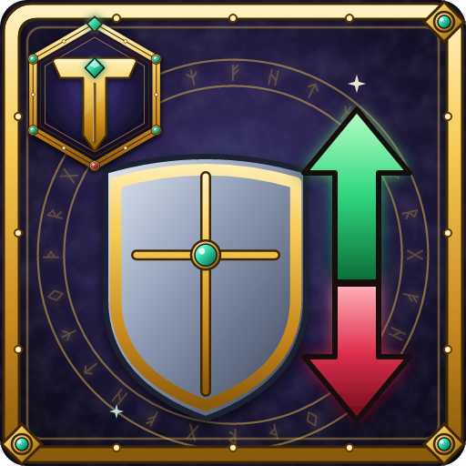

# Tylesser - Stat Delta

A World of Warcraft addon that shows **what you gain or lose** if you equip an item instead of the gear you're wearing. Hold **Shift** over an item, just like Blizzard's item compare, and the item's tooltip gets a **Stat Delta** section at the bottom. It lists the change in each stat, green for a gain and red for a loss, including the stats you get from other stats, like Attack Power from Strength or Health from Stamina.

## Features

- **In the item's tooltip, only while Shift is held.** Without Shift the tooltip looks as usual, and Blizzard's compare tooltips stay unchanged. It uses the same key as Blizzard's compare (Shift unless you changed it) and also follows the "always compare items" option. Works for items in your bags, at vendors, in the auction house, on loot, on other players (inspect) and in chat links.
- **Works with other addons' tooltips,** such as DialogueUI's quest reward tooltips, and the item tooltips of bag and quest addons.
- **Two sections:** **Item stats** are the differences in the stats printed on the items. **Your character** shows the totals after your class turns stats into other stats, when they differ from the printed ones.
- **Stats from other stats** (Classic Era and WoW Forever), based on your class:
  - Strength and Agility → **Attack Power** and **Ranged Attack Power**
  - Stamina → **Health**, Intellect → **Mana**, Agility → **Armor**
  - At level 60: Agility → **Crit** and **Dodge**, Intellect → **Spell Crit**. These are estimates and start with `~`.
- **Equip effects** are counted: Spell Damage, Healing, damage of one school (Fire, Shadow...), Attack Power, Attack Power in forms, Hit, Crit, Spell Hit, Spell Crit, Mana and Health per 5 sec, Defense, Dodge, Parry, Block, Block Value, ratings.
- Also: Armor, Weapon DPS, Strength, Agility, Stamina, Intellect, Spirit and resistances.
- **Rings and trinkets** are compared with both equipped ones, or with the empty slot if you have one free.
- **Weapons:** a two-handed weapon is compared with your main hand and off hand together. A one-handed weapon is compared with each weapon you dual wield. An off-hand item is compared with your two-handed weapon if you use one.
- Set bonuses, "Use:" and "Chance on hit:" effects are not counted.
- **Upgrade score (optional):** pick a preset for your class and role in the options (for example Warrior Tank or DPS, Priest Healer or Shadow, Druid Bear, Cat, Healer or Balance) and Stat Delta adds a line like **Upgrade: +4.2%** under each "Compared to" heading: green if the item scores higher than what you wear, red if lower. When the equipped item scores 0 (or the slot is empty), it shows the difference in points instead. The presets are **rough starting values** for Classic Era, not exact numbers: you can change the points for every stat. The score is saved per character (one for each talent group if you have dual spec: switching talents brings back that group's score) and is off until you pick a preset. Choosing "Off" clears the points. The score is made for **Classic Era and WoW Forever**: on other game versions gear has ratings the score doesn't count, so the score and the arrows are off there.
- **Upgrade arrows:** once you've picked a preset, items that score higher than what they'd replace get a small green arrow in the top right corner in your bags (Blizzard's bags and Baganator) and on quest rewards. The arrows don't need Shift. Items your character can't use yet (wrong armor type or weapon skill, level too low) get no arrow. You can turn the arrows off in the options.

On other game versions (TBC, Wrath, Mists, Retail) the addon shows only the stats printed on the items, without the conversions.

The addon reads the item tooltip text. On every client language it reads Strength, Agility, Stamina, Intellect, Spirit, Armor, Block, resistances and weapon damage, speed and DPS, using the game's own words for them (numbers written like 1,234, 1.234 or 1 234 all work). The "Equip:" effects (Spell Damage, Healing, Attack Power, Hit, Crit and the others) are read only on an **English** client; on other languages those lines are skipped.

### How the score counts stats

The score of an item is the sum of each stat times its points. Attack Power, Ranged Attack Power, Health, Mana and Armor count your character's totals, so they already include what Strength, Agility, Stamina and Intellect give you. All other stats count as printed on the item. Give points to a stat **or** to what it turns into, not both: the Warrior DPS preset gives points to Attack Power (Strength counts through it) and only a few to Agility, for its crit.

## Usage

Hold Shift while hovering over an item. The options are in Esc > Options > AddOns > Tylesser - Stat Delta, or type `/sdelta`. On WoW Forever and Retail, the addon menu next to the minimap opens them too.

- `/sdelta` or `/sdelta options`: open the options (stat changes, upgrade score, arrows)
- `/sdelta on` / `/sdelta off`: turn the stat changes on or off
- `/sdelta primary`: show or hide Strength, Agility, Stamina, Intellect and Spirit
- `/sdelta feedback`: get the link to report a bug or suggest an idea

## Feedback

Found a bug or have an idea? Type `/sdelta feedback` in game to get the link, or go straight to [tylesser.com/feedback](https://tylesser.com/feedback/#statdelta).

No GitHub account? Join the [Tylesser Discord](https://discord.gg/n2rEB6mRxF) and post in #bug-reports or #ideas with the addon's tag; each post is copied to GitHub and the bot answers with the link.

## Installation

Install from CurseForge, or download the latest zip from [Releases](https://github.com/Tylesser/StatDelta/releases) and extract it to `Interface/AddOns`. The folder must be named `StatDelta`.

## Releasing (maintainers)

Releases are built by [BigWigsMods/packager](https://github.com/BigWigsMods/packager). Push a version tag to publish to GitHub Releases and CurseForge:

```
git tag v1.0.0
git push origin v1.0.0
```

## License

[MIT](LICENSE)
