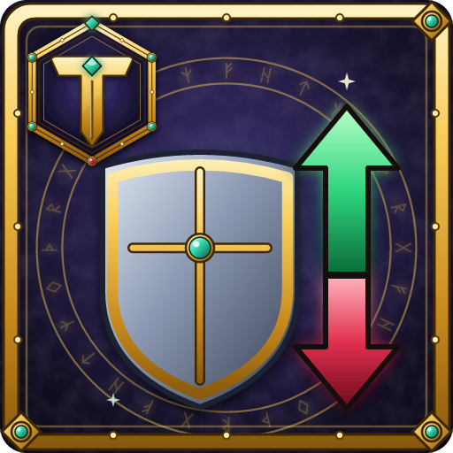

# Tylesser - Stat Delta

A World of Warcraft addon that shows **what you gain or lose** if you equip an item instead of the gear you're wearing. Hold **Shift** over an item, just like Blizzard's item compare, and the item's tooltip gets a **Stat Delta** section at the bottom. It lists the change in each stat, green for a gain and red for a loss, including the stats you get from other stats, like Attack Power from Strength or Health from Stamina.

## Features

- **In the item's tooltip, only while Shift is held.** Without Shift the tooltip looks as usual, and Blizzard's compare tooltips stay unchanged. It uses the same key as Blizzard's compare (Shift unless you changed it) and also follows the "always compare items" option. Works for items in your bags, at vendors, in the auction house, on loot and on other players (inspect).
- **Two sections:** **Item stats** are the differences in the stats printed on the items. **Your character** shows the totals after your class turns stats into other stats, when they differ from the printed ones.
- **Stats from other stats** (Classic Era and WoW Forever), based on your class:
  - Strength and Agility → **Attack Power** and **Ranged Attack Power**
  - Stamina → **Health**, Intellect → **Mana**, Agility → **Armor**
  - At level 60: Agility → **Crit** and **Dodge**, Intellect → **Spell Crit**. These are estimates and start with `~`.
- **Equip effects** are counted: Spell Damage, Healing, damage of one school (Fire, Shadow...), Attack Power, Attack Power in forms, Hit, Crit, Spell Hit, Spell Crit, Mana and Health per 5 sec, Defense, Dodge, Parry, Block, Block Value, ratings.
- Also: Armor, Weapon DPS, Strength, Agility, Stamina, Intellect, Spirit and resistances.
- **Rings and trinkets** are compared with both equipped ones, or with the empty slot if you have one free.
- **Weapons:** a two-handed weapon is compared with your main hand and off hand together. A one-handed weapon is compared with each weapon you dual wield. An off-hand item is compared with your two-handed weapon if you use one.
- Set bonuses, "Use:" and "Chance on hit:" effects are not counted.

On other game versions (TBC, Wrath, Mists, Retail) the addon shows only the stats printed on the items, without the conversions.

The addon reads the item tooltip text, so it needs an **English** game client.

## Usage

Hold Shift while hovering over an item. To turn the addon or parts of it on and off:

- `/sdelta`: show the settings
- `/sdelta on` / `/sdelta off`: turn the stat changes on or off
- `/sdelta primary`: show or hide Strength, Agility, Stamina, Intellect and Spirit

## Installation

Install from CurseForge, or download the latest zip from [Releases](https://github.com/Tylesser/StatDelta/releases) and extract it to `Interface/AddOns`. The folder must be named `StatDelta`.

## Releasing (maintainers)

Releases are built by [BigWigsMods/packager](https://github.com/BigWigsMods/packager). Push a version tag to publish to GitHub Releases and CurseForge:

```
git tag v1.0.0
git push origin v1.0.0
```

## License

[MIT](LICENSE)
